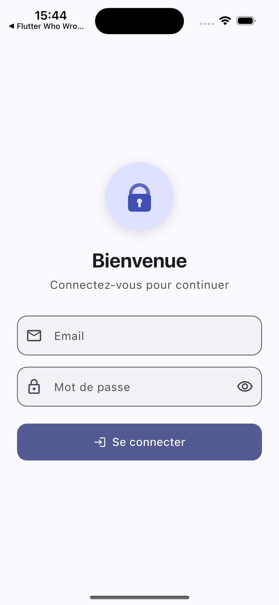
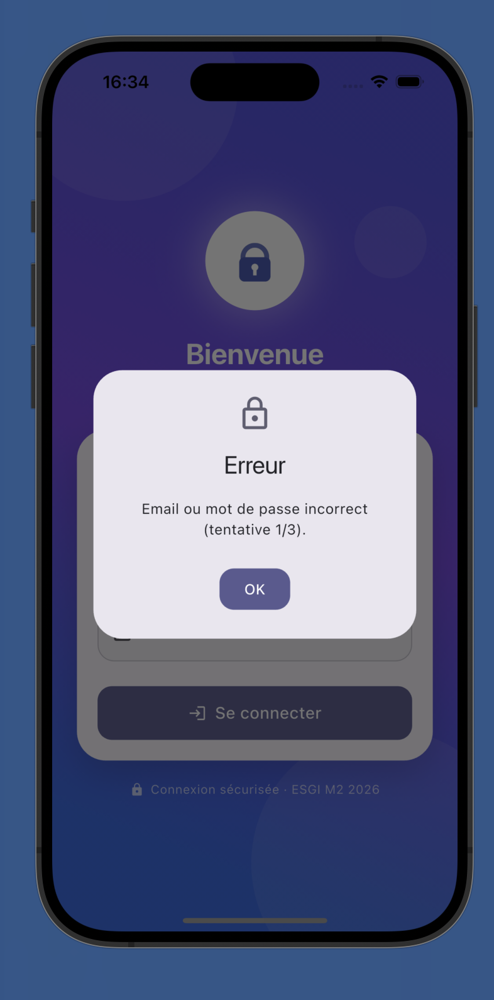
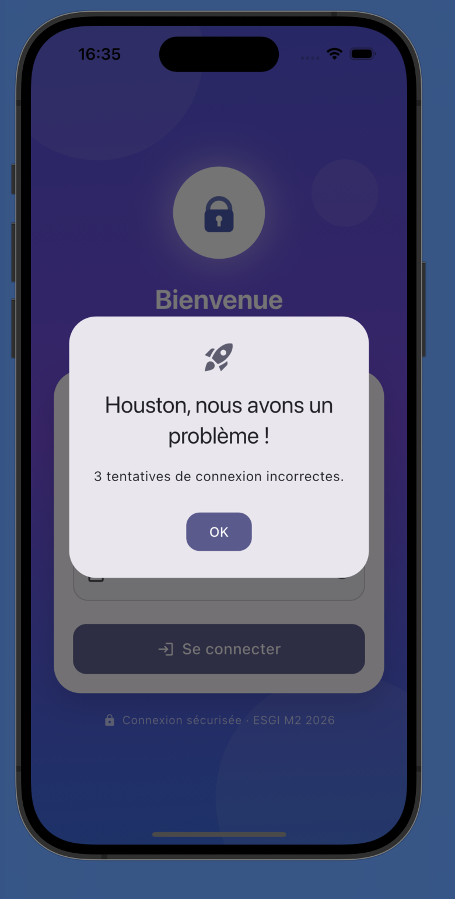
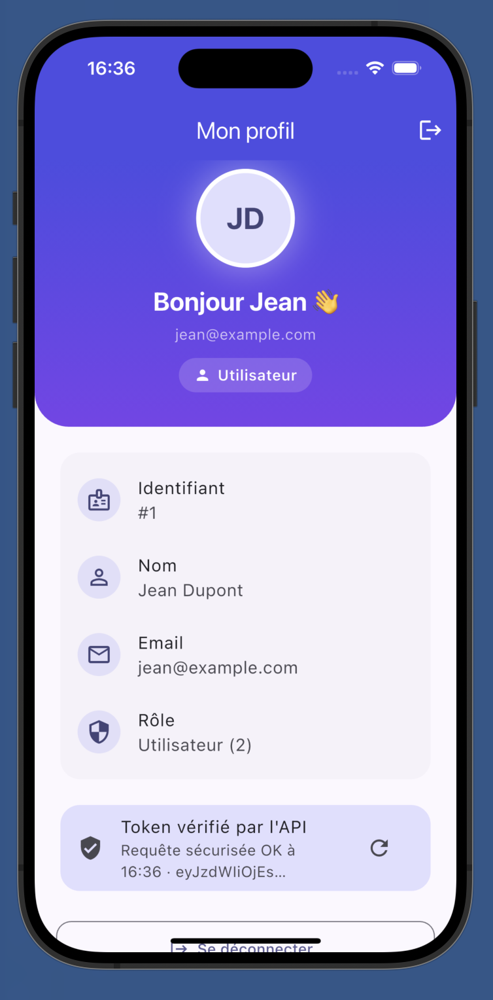
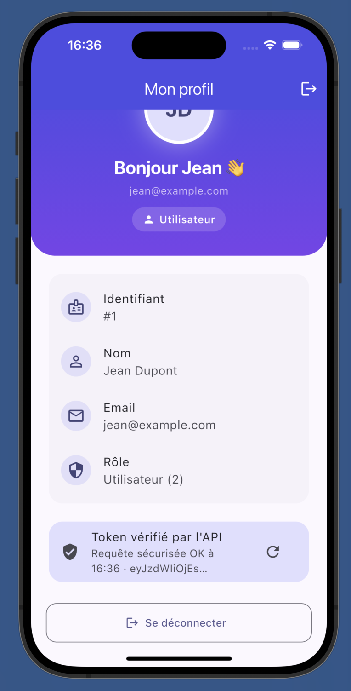
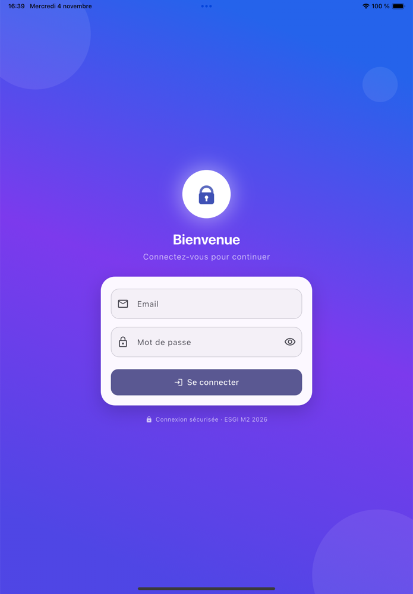
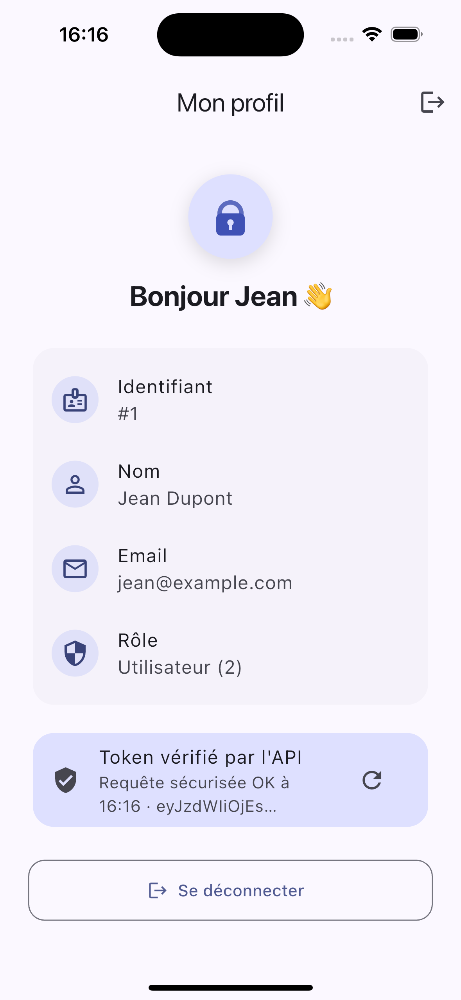

# DS Flutter – Connexion avec authentification via API REST

Application Flutter de connexion (évolution des TP 9.1 / 9.2) : l'authentification locale
est remplacée par des appels **HTTP** à une **API REST PHP** qui vérifie les mots de passe
hachés en **bcrypt**, renvoie le profil en JSON et délivre un **token signé** utilisé pour
sécuriser les requêtes suivantes.

**Option choisie : B** – adaptation du script PHP fourni (`api/login_tst_local.original.php`).

> L'application appelle **notre API** (`api/`) et non celle du professeur.

---

## ⚡ Vérifier rapidement (correcteur)

Prérequis : PHP ≥ 8 et Flutter installés.

```bash
git clone https://github.com/phasna/flutter_loging.git && cd flutter_loging
php -S 127.0.0.1:8000 -t api api/router.php   # Terminal 1 : lance l'API
flutter run                                    # Terminal 2 : lance l'app (simulateur iOS)
```
Se connecter avec `jean@example.com` / `1234`. Pour voir « Houston », se tromper 3 fois.

Tester l'API seule :
```bash
# Connexion
curl -X POST http://127.0.0.1:8000/login.php -H "X-Flutter-Student: M2-2026" \
  -d "email=jean@example.com&password=1234"
# Route protégée (remplacer <TOKEN> par le token reçu)
curl http://127.0.0.1:8000/profile.php -H "X-Flutter-Student: M2-2026" \
  -H "Authorization: Bearer <TOKEN>"
```

---

## Identifiants de test

| Email               | Mot de passe | Nom          | Rôle               |
|---------------------|--------------|--------------|--------------------|
| `jean@example.com`  | `1234`       | Jean Dupont  | 2 (Utilisateur)    |
| `julie@example.com` | `4321`       | Julie Martin | 1 (Administrateur) |

---

## Fonctionnalités

### Exigences obligatoires
- **3 tentatives incorrectes → « Houston, nous avons un problème ! »** (boîte de dialogue + bandeau).
  Le compteur est **remis à zéro après une connexion réussie**. Les erreurs réseau ne comptent pas.
- **En-tête `X-Flutter-Student: M2-2026`** envoyé à chaque requête (et exigé par l'API → `403` sinon).

### Application Flutter
- Formulaire `Form` + `TextFormField` validé (`GlobalKey<FormState>`, `validator`).
- `POST /login.php` avec le package `http` (`async`/`await`), paramètres `email` et `password`.
- Lecture du JSON (`status`, `message`, `id`, `firstName`, `lastName`, `email`, `role`, `token`).
- Erreurs gérées : identifiants faux, token invalide (401), serveur injoignable, délai dépassé (10 s),
  réponse non JSON.
- **Token** : stocké avec `flutter_secure_storage` (Keychain iOS / Keystore Android), envoyé en
  `Authorization: Bearer` sur `GET /profile.php` (requête sécurisée), **reconnexion automatique**
  au démarrage si le token est encore valide, supprimé à la déconnexion.
- `CircularProgressIndicator` pendant la connexion, au démarrage et lors de la vérification du token.
- Design réactif : `SingleChildScrollView` + largeur max (testé en 320×568, paysage 568×320, tablette).
- Interface : thème Material 3 clair/sombre, logo animé (fondu + zoom, `Hero`), transitions,
  afficher/masquer le mot de passe, bandeau animé des échecs.
- Gestion d'état : `ChangeNotifier` (`AuthController`) + `ListenableBuilder`.

### API PHP (`api/`)
| Fichier | Rôle |
|---|---|
| `login.php` | `POST` – authentification, renvoie le profil + token |
| `profile.php` | `GET` – route protégée par `Authorization: Bearer <token>` |
| `helpers.php` | réponses JSON, contrôles méthode / en-tête, création et vérification des tokens |
| `users.php` | utilisateurs avec **hash bcrypt** (jamais de mot de passe en clair) |
| `config.php` | en-tête attendu, durée du token, clé secrète (`TOKEN_SECRET`) |
| `router.php` | routeur du serveur PHP intégré (n'expose que `login.php` et `profile.php`) |
| `.htaccess` | même protection sur un hébergement Apache |
| `login_tst_local.original.php` | script d'origine fourni (référence) |

Sécurité :
- Mots de passe hachés avec `password_hash` (**bcrypt**, coût 12, **sel intégré**), vérifiés avec `password_verify`.
- `POST` obligatoire sur le login (`405` sinon), validation des entrées (email valide, longueurs max → `400`).
- Message d'erreur générique (ne révèle pas si l'email ou le mot de passe est faux).
- Token **signé HMAC-SHA256**, contenant l'id utilisateur et une **expiration (1 h)** ;
  toute modification invalide la signature → `401`.
- Mot de passe transmis dans le corps de la requête (jamais dans l'URL), via **HTTPS** en production.

**Contrat :**
```json
// POST /login.php – succès (HTTP 200)
{"status":200,"message":"Success","id":1,"firstName":"Jean","lastName":"Dupont",
 "email":"jean@example.com","role":2,"token":"…"}
// POST /login.php – erreur (HTTP 400)
{"status":400,"message":"Error"}
// GET /profile.php – token invalide (HTTP 401)
{"status":401,"message":"Unauthorized"}
```

---

## Structure du projet

```
api/                            API PHP (voir tableau ci-dessus)
lib/
  main.dart                     point d'entrée
  config/api_config.dart        URL de l'API, en-tête, timeout, nb max d'échecs
  models/                       User, LoginResponse, AuthException
  services/auth_service.dart    appels HTTP (login, profil sécurisé)
  services/token_storage.dart   stockage sécurisé du token
  state/auth_controller.dart    état : chargement, utilisateur, token, compteur d'échecs
  screens/                      StartupScreen, LoginScreen, ProfileScreen
  widgets/                      AppLogo, LoadingButton, AttemptsBanner, ProfileInfoTile
  theme/app_theme.dart          thème Material 3
test/widget_test.dart           17 tests (service, token, compteur Houston, interface, réactivité)
docs/screenshots/               captures d'écran
```

---

## Lancer le projet

### 1. API (PHP ≥ 8)
```bash
php -S 127.0.0.1:8000 -t api api/router.php
# Clé de signature personnalisée (recommandé) :
TOKEN_SECRET="une-longue-cle-aleatoire" php -S 127.0.0.1:8000 -t api api/router.php
```
Générer le hash bcrypt d'un nouveau mot de passe :
```bash
php -r 'echo password_hash("monMotDePasse", PASSWORD_BCRYPT), PHP_EOL;'
```

**HTTPS** – exposer l'API locale en HTTPS avec Cloudflare Tunnel :
```bash
cloudflared tunnel --url http://127.0.0.1:8000
# → https://xxxx.trycloudflare.com
```
ou déployer le dossier `api/` sur un hébergement PHP en HTTPS (le `.htaccess` est fourni).

### 2. Application Flutter
```bash
flutter pub get
flutter run                                                        # API locale
flutter run --dart-define=API_BASE_URL=https://xxxx.trycloudflare.com   # API en HTTPS
```
- Simulateur iOS : `127.0.0.1` fonctionne directement.
- Émulateur Android : `--dart-define=API_BASE_URL=http://10.0.2.2:8000`.

### 3. Tests
```bash
flutter test
```

---

## Captures d'écran

| Connexion | Erreur (1/3) | Houston (3/3) |
|---|---|---|
|  |  |  |

| Profil | Token vérifié par l'API |
|---|---|
|  |  |

Tablette (design réactif) :



### Démo en HTTPS (Cloudflare Tunnel)

L'API locale a été exposée en HTTPS (`cloudflared tunnel --url http://127.0.0.1:8000`) et
l'application lancée avec :
```bash
flutter run --dart-define=API_BASE_URL=https://samuel-fwd-federal-median.trycloudflare.com
```
Résultat vérifié le 04/11/2026 :
```text
POST https://…trycloudflare.com/login.php   → {"status":200,"message":"Success","id":1,"firstName":"Jean",…,"token":"…"}
GET  https://…trycloudflare.com/profile.php → {"status":200,"message":"Success","id":1,…}   (Authorization: Bearer)
POST login.php (mauvais mot de passe)       → {"status":400,"message":"Error"}
```
Capture ci-dessous : au redémarrage de l'app, la session est **restaurée automatiquement** à partir
du token stocké dans `flutter_secure_storage`, puis le token est **vérifié par l'API en HTTPS**.



> L'adresse `trycloudflare.com` est temporaire (elle change à chaque lancement du tunnel) :
> relancer `cloudflared` et utiliser la nouvelle adresse pour reproduire.
