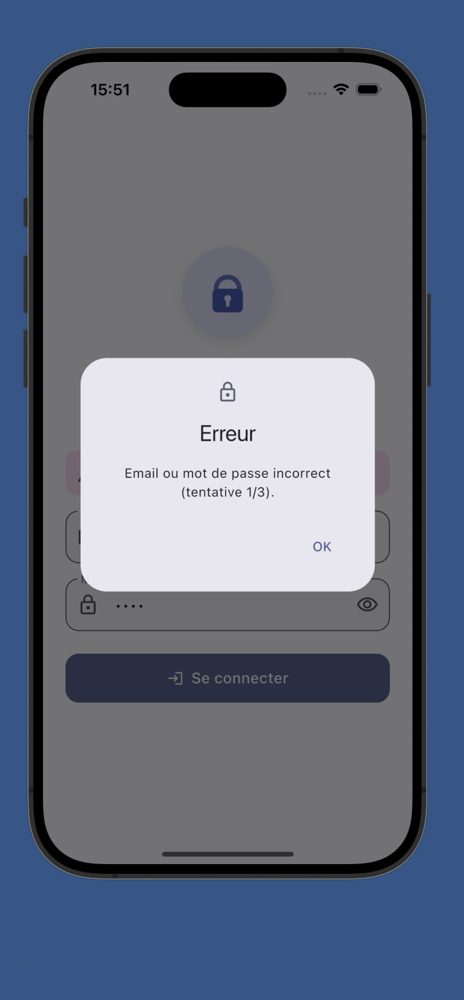
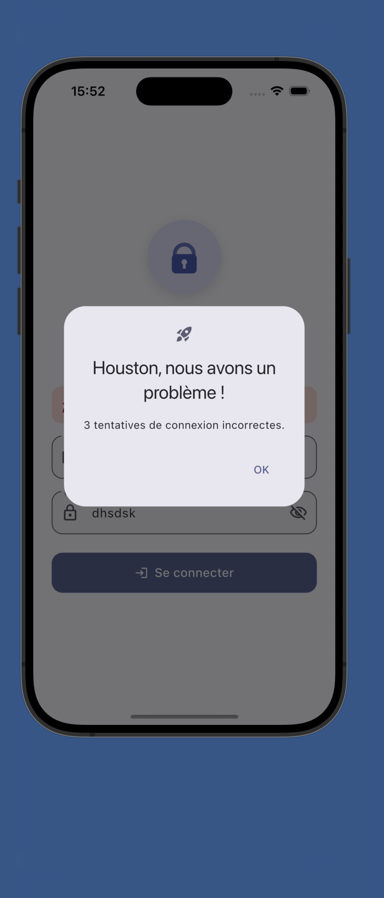
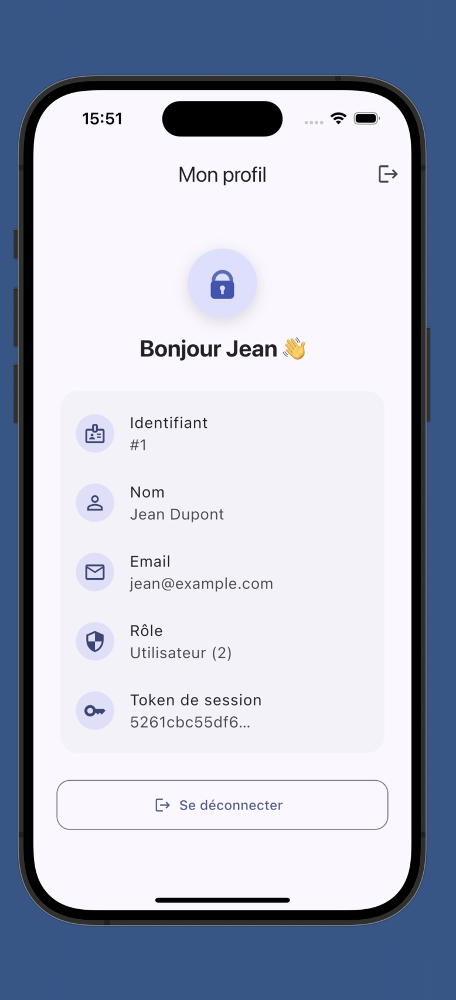

# DS Flutter – Connexion avec authentification via API REST

Application Flutter de connexion (évolution des TP 9.1 / 9.2) : l'authentification locale
est remplacée par un appel **POST** à une **API REST PHP** qui vérifie les mots de passe
hachés en **bcrypt** et renvoie le profil de l'utilisateur en JSON.

**Option choisie : B** – adaptation du script PHP fourni (`api/login_tst_local.original.php`)
→ `api/login.php`.

---

## ⚡ Vérifier rapidement (correcteur)

Prérequis : PHP ≥ 8 et Flutter installés.

```bash
git clone https://github.com/phasna/flutter_loging.git && cd flutter_loging
php -S 127.0.0.1:8000 -t api     # Terminal 1 : lance l'API (option B)
flutter run                      # Terminal 2 : lance l'app (simulateur iOS)
```
Se connecter avec `jean@example.com` / `1234`. Pour voir le message « Houston », se tromper 3 fois de mot de passe.

Tester l'API seule :
```bash
curl -X POST http://127.0.0.1:8000/login.php -H "X-Flutter-Student: M2-2026" \
  -d "email=jean@example.com&password=1234"
```

> L'application appelle **notre API** (`api/login.php`) et non celle du professeur.
> Émulateur Android : `flutter run --dart-define=API_URL=http://10.0.2.2:8000/login.php`

---

## Identifiants de test

| Email               | Mot de passe | Nom          | Rôle               |
|---------------------|--------------|--------------|--------------------|
| `jean@example.com`  | `1234`       | Jean Dupont  | 2 (Utilisateur)    |
| `julie@example.com` | `4321`       | Julie Martin | 1 (Administrateur) |

---

## Fonctionnalités

### Application Flutter
- Formulaire `Form` + `TextFormField` validé (`GlobalKey<FormState>`, `validator`).
- Appel **POST** avec le package `http` (`async`/`await`), paramètres `email` et `password`.
- En-tête obligatoire **`X-Flutter-Student: M2-2026`** envoyé à chaque requête.
- Lecture de la réponse JSON (`status`, `message`, `id`, `firstName`, `lastName`, `email`, `role`, `token`).
- **3 tentatives incorrectes → « Houston, nous avons un problème ! »**
  (boîte de dialogue + bandeau). Le compteur est **remis à zéro après une connexion réussie**.
  Les erreurs réseau ne sont pas comptées comme des tentatives incorrectes.
- Gestion des erreurs : identifiants faux, serveur injoignable, délai dépassé (10 s), réponse invalide.
- `CircularProgressIndicator` dans le bouton pendant la connexion (champs désactivés).
- Design réactif : `SingleChildScrollView` + largeur max (portrait / paysage / tablette).
- Interface : thème Material 3 clair/sombre, logo animé (fondu + zoom, `Hero` vers le profil),
  afficher/masquer le mot de passe, bandeau animé du nombre d'échecs.
- Écran de profil (id, nom, email, rôle, début du token) + déconnexion.
- Gestion d'état avec un `ChangeNotifier` (`AuthController`) + `ListenableBuilder`.

### API PHP (`api/login.php`)
- Mots de passe **jamais stockés en clair** : hachés avec `password_hash` (bcrypt, coût 12),
  vérifiés avec `password_verify` (sel intégré au hash bcrypt).
- **POST** obligatoire (sinon `405`).
- En-tête **`X-Flutter-Student: M2-2026`** obligatoire (sinon `403`).
- Validation des entrées (email valide, longueurs max) → `400`.
- Accepte les paramètres en `application/x-www-form-urlencoded` ou en JSON.
- Génère un **token** de session aléatoire (`random_bytes`) en cas de succès.
- Message d'erreur générique (ne révèle pas si c'est l'email ou le mot de passe qui est faux).

**Contrat :**
```json
// Succès (HTTP 200)
{"status":200,"message":"Success","id":1,"firstName":"Jean","lastName":"Dupont",
 "email":"jean@example.com","role":2,"token":"…"}
// Erreur (HTTP 400)
{"status":400,"message":"Error"}
```

---

## Structure du projet

```
api/
  login.php                     API d'authentification adaptée (bcrypt, en-tête, validation)
  login_tst_local.original.php  script d'origine fourni (référence)
lib/
  main.dart                     point d'entrée
  config/api_config.dart        URL de l'API, en-tête, timeout, nb max d'échecs
  models/                       User, LoginResponse, AuthException
  services/auth_service.dart    appels HTTP à l'API
  state/auth_controller.dart    état : chargement, utilisateur, token, compteur d'échecs
  screens/                      LoginScreen, ProfileScreen
  widgets/                      AppLogo, LoadingButton, AttemptsBanner, ProfileInfoTile
  theme/app_theme.dart          thème Material 3
test/widget_test.dart           10 tests (service, compteur Houston, interface)
docs/screenshots/               captures d'écran
```

---

## Lancer le projet

### 1. API (PHP ≥ 8)
```bash
php -S 127.0.0.1:8000 -t api
```
Test rapide :
```bash
curl -X POST http://127.0.0.1:8000/login.php \
  -H "X-Flutter-Student: M2-2026" \
  -d "email=jean@example.com&password=1234"
```

Générer le hash d'un nouveau mot de passe :
```bash
php -r 'echo password_hash("monMotDePasse", PASSWORD_BCRYPT), PHP_EOL;'
```

**HTTPS** : en production, déployer `api/login.php` sur un hébergement PHP en HTTPS
(ou exposer l'API locale en HTTPS, ex. `cloudflared tunnel --url http://127.0.0.1:8000`).

### 2. Application Flutter
```bash
flutter pub get
flutter run                                   # API locale http://127.0.0.1:8000/login.php
flutter run --dart-define=API_URL=https://mon-serveur/login.php   # autre URL (HTTPS)
```
- Simulateur iOS : `127.0.0.1` fonctionne directement.
- Émulateur Android : `--dart-define=API_URL=http://10.0.2.2:8000/login.php`.
- L'app fonctionne aussi avec l'API du professeur :
  `--dart-define=API_URL=https://temp.itds.fr/login_tst_local.php`.

### 3. Tests
```bash
flutter test
```

---

## Captures d'écran

| Connexion | Erreur | Houston | Profil |
|---|---|---|---|
|  |  |  |  |

---

## Sécurité – notes
- Le mot de passe est transmis dans le corps de la requête POST (jamais dans l'URL) ;
  il doit l'être via **HTTPS** en production.
- Côté serveur, seuls des **hash bcrypt** sont stockés.
- Le token est conservé en mémoire pendant la session et effacé à la déconnexion.
